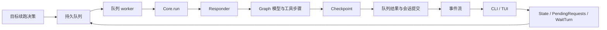

# CLI/TUI 与 Core 工程审计（2026-10-29）

范围：luneAgent CLI/TUI、A2A、构建流程，以及兄弟仓库 luneCore 的执行、恢复和持久化路径。Desktop 不在范围内。审查起点为 Agent `f88f50c`、Core `0cd9e49`。

## 本轮已复现并修复

| 优先级 | 问题与影响 | 修复与证据 |
| --- | --- | --- |
| P1 | Core 用量、设置、授权等更新会回写旧会话快照。原 SQL 保留新 history，却覆盖新 model_context、model_context_key、agent_context，可能恢复旧 provider 状态或工具发现状态。 | `internal/session/store.go` 保留整组由 conversation 更新路径拥有的字段。回归覆盖新上下文、清空上下文，以及 JSON 标量，确保旧快照不能复活缓存，且用量和设置仍能更新。 |
| P1 | A2A 在任务表全局锁内执行 CreateSession/OpenSessionRuntime/SubmitTurn。慢初始化阻塞其他任务查询；Close 无法及时取得锁，关停 deadline 失去作用。 | 提交串行控制与任务表锁分离。初始化绑定可取消的 admission context，Close 先取消初始化，再等待已接受任务完成登记，随后取得任务快照。回归覆盖响应取消的后端、不响应取消的后端、无关任务查询，以及“Core 已接受、A2A 尚未登记”的关停竞态。 |
| P2 | Linux 构建默认启用仓库中未跟踪的 go.work，与维护文档相反。相同提交可能构建到未发布的本地 Core，掩盖固定依赖问题。 | Linux 和 PowerShell 标准构建默认 GOWORK=off；显式配置继续生效。PowerShell 退出时恢复原环境。Linux 用替身 Go 验证未设置、空值、显式路径三个场景，每个场景检查全部六次构建均携带 -trimpath。 |
| P2 | Agent 仍固定旧 Core `b0fb17a`，上一轮已推送的目标中断校验与完整队列修复不会进入独立构建。 | go.mod 固定到已发布提交 `423444b`，包含上一轮 `0cd9e49` 及本轮快照修复；用 GOWORK=off 运行支持包测试，避免本地工作区掩盖依赖版本。 |

本轮 Core 快照修复已随 `423444b` 提交、推送；Agent 已同步固定该版本。发布顺序保持为先推送 Core，再更新 Agent 的固定版本并重跑独立模块验证。

SQL 的另一处边界也随本轮修复解决：json_extract 会把 JSON 字符串解包，随后 json(...) 可能将其当作非法 JSON。保留 conversation 字段时改为读取 JSON 表示，确保字符串、布尔、数字和 null 不发生类型变化。

## 复杂度主要来自哪里

当前普通任务大致经过以下路径；每层并非都应删除，但状态判定的重复值得收敛：

### 1. 完成、暂停与下一轮调度的所有权分散

`session_queue_worker.go` 的主循环与 defer 都会决定后续调度、检查队列和触发目标续跑。`Core.run` 更新内存任务状态，worker 再结合队列状态、checkpoint 和 durable result 判断结束方式；恢复又在 `session_queue_recovery.go` 重建这些关系。

风险不只是调用层数：一次状态变化需要多个表示相互对账，因而产生窗口修复、重复通知和“刚暂停时用户已回答”的补偿路径。上一轮的完整队列漏报、本轮快照字段回滚，都说明状态与字段所有权仍不够明确。

建议下一步先收敛普通任务的结束提交：worker 负责一个结束决策，存储层原子提交结果、conversation、队列和事件；内存状态与 UI 状态作为投影。保留进程重启后的恢复，不再让正常完成路径依赖恢复逻辑补齐结果。先做这一条路径，再扩展到暂停和恢复，不新建通用 workflow 框架。

验收：完成、取消、预算暂停、问答暂停都只能产生一个稳定结果；任意提交边界重启后能恢复；事件重复投递不会再次执行工具或产生第二个终态。

### 2. 会话快照写入边界仍然过宽

`usageMu` 串行化多个“读取会话、改少数字段、写回整个 JSON”的更新。conversation、title、archived 已由独立 SQL 更新，因此 Save 必须额外保护它们。本轮修复了漏保护的上下文字段，但整份快照回写仍容易在新增字段时重现同类问题。

建议把用量、设置、授权分别限制到其拥有的字段，用单次 SQL 更新或事务完成修改；会话创建保留完整插入。不要先引入通用 Repository、事件溯源框架或大量接口。只有字段级写入消除跨操作覆盖后，再评估缩小 usageMu 的范围。

验收：并发更新用量、设置、conversation、标题、授权，所有修改均保留；新增会话字段不需要修改一张不断扩大的“禁止被 Save 覆盖”清单。

### 3. 前端承担过多运行状态协调

TUI 同时处理事件流、State/PendingRequests 查询和 WaitTurn 结果，并保存 awaitingTurns、terminalEvents、interruptedExecutions、questionSubmissions 等协调状态。这些状态中有用于异步会话切换的必要身份，也有用于弥补 Core 终态时序的补偿。

建议在 Core 完成提交边界收敛后，逐项移除可由 Core 确定的终态补偿。保留 session binding generation、订阅 cursor、输入草稿和渲染缓存：这些分别解决异步身份、断线重连和交互性能，不能因为字段多而一并删除。

验收：切换 A→B→A 时旧消息不会污染当前会话；流断开重连后状态一致；前端无需通过多条路径争抢同一个任务的终态解释权。

### 4. goalRuns 混合了两个生命周期

`goalRuns[executionID]` 存执行关联，但同一 map 的 `"session:"+sessionID` 键还存会话级 NoInteractiveDecisions 配置。这迫使执行数据结构同时承担会话配置职责，也让清理规则隐含在字符串命名中。

建议把会话目标运行配置与目标是否 armed 放在同一个会话级状态中，goalRuns 只存执行关联。此项是有具体冲突点的小型所有权整理，不应扩展成策略接口或插件机制。

## 与其他 agent 源码的对照

[pi 的 agent loop](https://github.com/earendil-works/pi/blob/main/packages/agent/src/agent-loop.ts) 在同一循环内处理工具步骤、steering 和后续输入。可借鉴的是把“是否继续”放在清晰的边界；这不能证明它与 Lune 的持久 checkpoint 恢复具有相同复杂度。

[Crush 的 Go orchestration](https://github.com/charmbracelet/crush/blob/main/internal/agent/agent.go) 也有队列、活动请求、accept 计数和取消序号，并明确将 dispatch 锁限制在短暂交接期间。这说明并发 agent 本身存在必要复杂度；可以直接借鉴短锁边界，不能据文件数量或行数断言整个实现更简单。

基于这些局部对照，我认为 Lune 明显值得压缩的是重复的状态判定、正常结束与恢复补偿的交织、以及整份 JSON 快照回写。图执行、权限元数据、按需工具发现、provider context 与用户 transcript 分离都有实际用途，本轮没有据此提出删除它们。

## 尚未修复的边界与下一步

- **关停中的任务操作等待**：本轮解决 admission 阻塞。Close 后续仍会等待 task.opMu，且 ResolveApprovalDecision/Interrupt 等接口不接收 context。对于不响应取消的宿主操作，不能据 admission 测试宣称整个关停路径都具有硬 deadline。应先补这一边界的阻塞测试，再决定向 Core 控制操作传递 context 的最小改动。
- **目标创建、恢复的检查与提交分离**：CreateGoal/ResumeGoal 先读取任务状态，再取得目标锁并提交；普通 SubmitTurn 使用另一组同步。静态审查显示并发调用可能使检查过时，本轮未完成确定性复现，不能列为已证实竞态。下一步应建立可控交接测试，再统一 admission 边界。
- **升级修复留在打开会话热路径**：旧中断修复、旧 checkpoint 清理与常规 OpenSessionRuntime 混在一起，部分路径会扫描事件。建议移到明确的一次性升级边界；已有真实旧数据修复用途，不能仅为删代码而直接丢弃。

建议顺序：先解决可验证的关停与 admission 边界，再收敛一次普通任务的终态提交，随后缩小会话快照写入范围，最后删除已失去用途的前端补偿与升级分支。

## 验证范围

- Core：独立模块全量测试、vet；session/runtime/tool/command/mcp 竞态检测。SQL 最终调整后重跑 session/runtime 竞态检测与全量测试。
- Agent：固定依赖版本的 CLI/TUI 支持包测试；联动本地 Core 的 A2A/app/CLI/TUI 竞态检测与 vet；Linux、Windows CLI 交叉构建，均带 -trimpath。
- 构建脚本：Linux Bash 语法和三种 GOWORK 环境的六次构建调用检查。
- 未执行：Windows 原生 PowerShell、真实模型 API、Desktop、GUI 输入法实机验证。
